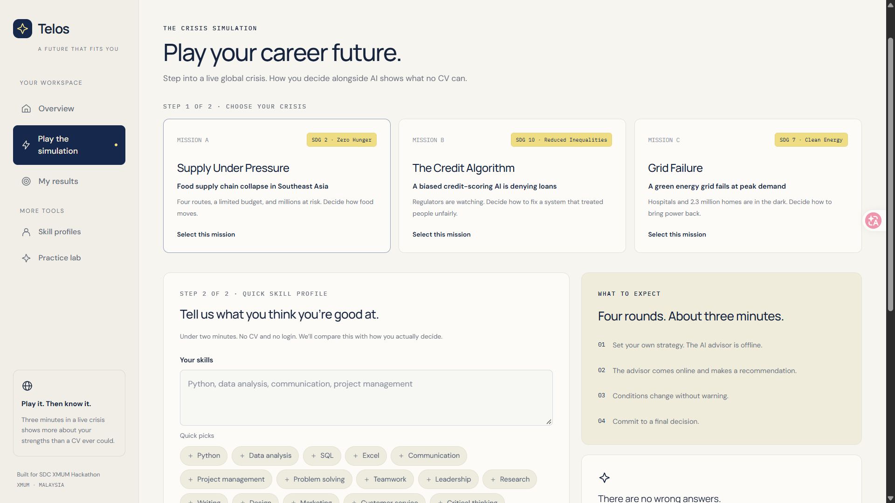

# Telos — Human–AI Decision Lab & Career Intelligence

> **Telos** is an interactive simulation platform that evaluates human–AI decision-making under crisis to generate authentic behavioral skill profiles and personalized career pathways.



---

## Overview

Traditional CVs and static questionnaires fail to reveal how individuals actually think, adapt, and collaborate with AI under pressure. **Telos** replaces self-reported claims with an interactive 4-round crisis simulation. By measuring how users respond to incomplete information, conflicting priorities, shock events, and AI recommendations, Telos objectively evaluates behavioral competencies and pairs candidates with optimal future-proof roles.

---

## Features

- **Interactive Crisis Control Room**: Experience high-stakes 4-round scenarios (e.g., *Southeast Asia Food Supply Chain Disruption*, *Credit Scoring Algorithmic Bias*) with live briefings, data evidence, and unforeseen shocks.
- **Behavioral Competency Scoring**: Evaluates six core dimensions: Critical Thinking, Systems Thinking, Crisis Management, Ethical Reasoning, Resilience, and AI Literacy.
- **AI Literacy & Oversight Auditing**: Analyzes whether users blindly delegate decisions to AI or independently verify evidence and recognize model limitations.
- **Semantic Career Matching**: Matches evaluated behavioral competencies and user interests against ESCO-aligned career roles using dense semantic embeddings (BGE-M3).
- **Personalized Learning Pathways**: Automatically generates milestone-based upskilling roadmaps tailored to user-specified weekly learning hours and identified skill gaps.
- **Zero-Exposure Server Proxy**: Next.js App Router server-side API proxy isolates backend secrets and operator tokens from client browsers.

---

## Tech Stack

| Layer | Technologies |
| :--- | :--- |
| **Frontend** | [Next.js 16](https://nextjs.org/) (App Router), [React 19](https://react.dev/), [Tailwind CSS v4](https://tailwindcss.com/), TypeScript |
| **Backend** | [FastAPI](https://fastapi.tiangolo.com/), [Pydantic v2](https://docs.pydantic.dev/), [Uvicorn](https://www.uvicorn.org/), Python 3.12+ |
| **AI / ML** | [RunPod Serverless](https://www.runpod.io/) (BGE-M3 Dense Embeddings & LLM inference) |
| **Database** | [Supabase](https://supabase.com/) (PostgreSQL with Row-Level Security) |
| **Package Management** | `uv` / `pip` (Python), `npm` (Node.js) |

---

## Getting Started

### Prerequisites

Ensure you have the following installed on your machine:
- **Node.js**: v20.x or higher
- **Python**: v3.12 or higher
- **uv** (recommended) or **pip**
- **Git**

---

### Installation

1. **Clone the repository:**
   ```bash
   git clone https://github.com/Ivannov-arch/telos-sdc.git
   cd telos-sdc
   ```

2. **Set up the Python backend:**
   ```bash
   # Using uv (fastest)
   uv sync
   # Or using standard pip
   pip install -r src/backend/requirements.txt
   ```

3. **Set up the Next.js frontend:**
   ```bash
   cd src/frontend
   npm install
   cd ../..
   ```

---

### Environment Variables

#### 1. Backend Configuration (`src/.env`)
Create a file at `src/.env` with the following variables:

```env
# Supabase
SUPABASE_URL=https://your-project.supabase.co
SUPABASE_PUBLISHABLE_KEY=your_publishable_key
SUPABASE_SECRET_KEY=your_service_role_secret_key

# RunPod Serverless AI
RUNPOD_API_KEY=your_runpod_api_key
RUNPOD_BGE_M3_URL=https://api.runpod.ai/v2/<endpoint-id>/runsync

# Internal Shared Token
API_ACCESS_TOKEN=telos-sdc-dev-key-2026

# Server Configuration
API_HOST=0.0.0.0
API_PORT=8000
```

#### 2. Frontend Configuration (`src/frontend/.env.local`)
Create a file at `src/frontend/.env.local`:

```env
# Must match backend API_ACCESS_TOKEN
API_ACCESS_TOKEN=telos-sdc-dev-key-2026

# Backend endpoint (Local or Hosted)
BACKEND_URL=http://127.0.0.1:8000
# For cloud deployment:
# BACKEND_URL=https://telos-sdc.onrender.com
```

---

### Running the Application

Both backend and frontend must be running simultaneously.

#### Terminal 1 — Backend (FastAPI)
From the project root:
```bash
uv run uvicorn backend.main:app --app-dir src --host 0.0.0.0 --port 8000 --reload
```
Interactive API documentation will be available at [http://127.0.0.1:8000/docs](http://127.0.0.1:8000/docs).

#### Terminal 2 — Frontend (Next.js)
```bash
cd src/frontend
npm run dev
```
Open [http://localhost:3000](http://localhost:3000) in your browser.

---

## 🎮 Usage

1. **Launch**: Navigate to `http://localhost:3000/play`.
2. **Onboarding**: Select your career interests, key skills, and available weekly learning hours.
3. **Crisis Control Room**:
   - **Round 1 (Initial Briefing)**: Formulate an initial strategy given limited budget and resources.
   - **Round 2 (AI Advisory)**: Receive recommendations from an AI advisor. Scrutinize the underlying data evidence before agreeing or overriding.
   - **Round 3 (Shock Event)**: Manage sudden budget cuts or disruptions; evaluate unvetted emergency proposals.
   - **Round 4 (Final Execution)**: Commit final decisions under acute constraints.
4. **Behavioral Report**: Review psychometric evaluations and AI collaboration scoring across 6 key metrics.
5. **Explore Career Pathways**: View matched future-proof roles, inspect skill gaps, and explore generated learning roadmaps.

---

## Project Structure

```text
telos-sdc/
├── src/
│   ├── backend/                 # FastAPI backend & analytical engines
│   │   ├── routers/             # API endpoints (game, match, profile, simulate)
│   │   ├── access.py            # Operator token validation & security
│   │   ├── db.py                # Supabase PostgreSQL client setup
│   │   ├── game_evaluator.py    # Behavioral scoring & psychometrics
│   │   ├── game_matcher.py      # Semantic career role matching
│   │   ├── game_pathway.py      # Personalized upskilling roadmap generation
│   │   ├── game_scenarios.json  # Multi-round crisis scenario bank
│   │   ├── main.py              # Application entrypoint & CORS
│   │   └── requirements.txt     # Python dependencies
│   ├── frontend/                # Next.js 16 web application
│   │   ├── src/
│   │   │   ├── app/             # App router pages (/play, /results, /profiles)
│   │   │   │   └── api/backend/ # Server-side proxy isolating API tokens
│   │   │   ├── components/      # Reusable UI components
│   │   │   └── lib/             # Typed API client and helper functions
│   │   └── package.json         # Frontend dependencies & scripts
│   └── .env                     # Backend environment configuration
├── submission/                  # Hackathon deliverables & platform proof-of-use
├── artifacts/                   # Design prototypes & UI blueprints
├── pyproject.toml               # Project metadata & Python configuration
└── README.md                    # Project documentation
```

---

## Key Engineering Decisions

- **Server-Side API Proxy Pattern**: Rather than distributing backend API keys or database tokens to client browsers, Next.js route handlers (`src/frontend/src/app/api/backend/[...path]/route.ts`) act as an authenticated proxy, injecting `API_ACCESS_TOKEN` securely on the server.
- **RunPod Serverless Embeddings**: Utilizing `BGE-M3` on RunPod serverless endpoints provides rapid 1024-dimensional semantic matching between player decision patterns and occupational taxonomies without paying for idle GPU hours.
- **FastAPI for Evaluation Engine**: Selected for native async execution, strict Pydantic schema validation, and instantaneous JSON serialization required for dynamic game rounds.
- **Supabase PostgreSQL & Row-Level Security (RLS)**: Enforces database-level isolation of user sessions and psychometric reports, protecting sensitive assessment data.

---

## Roadmap

- [x] 4-round crisis simulation engine with real-time shock events.
- [x] 6-dimension behavioral & AI-literacy scoring algorithm.
- [x] Semantic career role matching via RunPod BGE-M3.
- [x] Dynamic milestone-based learning pathway generator.
- [ ] Multi-user authentication & profile persistence (Supabase Auth).
- [ ] Multiplayer collaborative crisis simulations.
- [ ] Exportable PDF competency certifications.

---

## License

Distributed under the [Apache License 2.0](LICENSE). See `LICENSE` for more information.