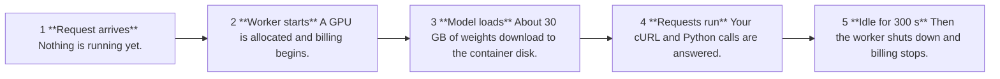

logo: runpod

## **Deploying Open Source Models on Runpod Serverless**

By Jessica Garson

## Agenda

### 01

### **Intro**

What is Runpod

### 02

### **Setting up**

What we need to get started

### 03

### **What is Runpod Serverless?**

Core concepts

### 04

### **What is a decision model?**

OpenJev's underlying framework

### 05

### **What you need to know before you deploy**

Avoiding mistakes

### 06

### **Deploying**

Let's deploy our endpoint

### 07

### **Making requests**

cURL + Python

### 08

### **Next steps**

What can you build next

© 2026 Runpod Inc. All rights reserved. Confidential and proprietary. | icon: cube logo

photo: Jessica Garson Beauchemin

## Hi, I'm Jessica Garson Beauchemin

icon: waving hand emoji

I lead Developer Relations at Runpod

icon: Runpod logo

logo: runpod

## The AI Developer Cloud

Experiment, train, fine-tune, deploy, scale on one AI system

**runpod.io**

image: 3D isometric diagram of the Runpod AI Developer Cloud infrastructure

logo: runpod

## **What you need to get started**

## Code from the workshop can be found here

github.com/runpod/openjev-serverless

© 2026 Runpod Inc. All rights reserved. Confidential and proprietary. | icon: Runpod logo

## This workshop is inspired by this article

www.runpod.io/blog/how-to-deploy-openjev-on-runpod-serverless

© 2026 Runpod Inc. All rights reserved. Confidential and proprietary. | icon: Runpod logo

## Prerequisites

* A Runpod account. The endpoint runs on an H100 80 GB, and you're billed only while a worker is running.
* A <u>Runpod API key</u>. Create one in the Runpod console under Settings and API Keys.
* <u>npm installed</u>
* <u>An AI coding assistant such as Claude Code</u>
* <u>Python 3 with the requests library. Install it with pip install requests.</u>
* <u>A terminal for sending requests and running the example script. cURL is</u> <u>useful for quick tests.</u>
* <u>A text editor of your choice for editing the Python code sample.</u>
* <u>Basic familiarity with JSON and HTTP requests.</u>

© 2026 Runpod Inc. All rights reserved. Confidential and proprietary. | icon: Runpod logo

logo: runpod

The AI Developer Cloud

## **What is Runpod Serverless?**

## **What is Runpod Serverless?**

### **Pay-as-you-go compute for AI models and compute-intensive workloads.**

screenshot: Runpod Hub interface showing Serverless Repos

© 2026 Runpod Inc. All rights reserved. Confidential and proprietary. | icon: Runpod logo

## **What you need to know about Serverless**

Pay as you compute

<hr/>

### **Compute without servers to manage**

You serve AI models for inference, or run other compute-heavy workloads, without provisioning or managing servers.

<hr/>

### **Pay only while workers run**

Workers scale to zero after a short idle timeout when no requests arrive. Startup and model loading are billed too.

<hr/>

### **Workers run your code in a container**

Runpod starts them when requests arrive and stops them when they’re idle.

© 2026 Runpod Inc. All rights reserved. Confidential and proprietary. | icon: Runpod logo

## Serverless core concepts

Technical considerations

<hr/>

### **Endpoints are the access point**

Each endpoint gives you a URL to send requests to, with its own GPU, scaling, and other settings.

<hr/>

### **Two endpoint types**

A queue-based endpoint uses a handler function and a request queue. A load balancer endpoint routes requests straight to your own HTTP server, such as FastAPI or Flask.

<hr/>

### **Cold starts are the tradeoff**

A request that arrives with no free worker waits for one to start and load the model. Cached models, FlashBoot, and active workers above zero reduce this.

© 2026 Runpod Inc. All rights reserved. Confidential and proprietary. | icon: Runpod logo

## The example we will deploy is OpenJev, a decision model

© 2026 Runpod Inc. All rights reserved. Confidential and proprietary. | icon: Runpod logo

logo: runpod

## **What is a decision model?**

## **Chat models answer in prose you have to parse**

| Reply 1 | Reply 2 | Reply 3 |
| --- | --- | --- |
| "3 stars" | "about a 3" | "I'd say 3 out of 5, because..." |

**Same question, three formats. Your code has to handle all of them.**

© 2026 Runpod Inc. All rights reserved. Confidential and proprietary. | icon: cube logo

## **Decision models answer in the format you ask for**

| choice | noul | score |
| --- | --- | --- |
| Pick one named option | Yes or no as a probability | Position on an ordered scale |
| Returns the choice and a confidence. | A number from 0 to 1. 0.98 means about 98% confident it is yes. | Returns a score, a legend that maps positions to labels, and a confidence. |

3

logo: runpod

## **What you need to know before you deploy**

## **Zero active workers, so you pay only while one runs**

| 1 | 0 | 300 s | $4.79 |
| --- | --- | --- | --- |
| max workers | active workers | idle timeout | per hour, H100 80 GB flex rate |
| One worker is plenty, and a burst of test requests can't start several GPUs. | The endpoint shuts down when idle. | The default is 5 s, so every request would pay for another model load. | As of Sept 27, 2026. A few dollars covers this tutorial. |

7

## **You pay from worker start, including model load**

flow_chart: 5-step process diagram showing worker lifecycle and billing status



**Billed from worker start until shutdown**

8

## **Cold starts take minutes, so check readiness first**

FlashBoot is on, but it does not speed up the very first boot.

| ~30 GB weights download on each cold start This lab uses no network volume. | ~2 min before a load balancer endpoint returns an error It does not hold your request while a worker starts. | 200 from /v1/version means the model is loaded "no workers available" is normal. Keep waiting. |
| --- | --- | --- |

9

## **Three mistakes cost real GPU time, each with a fix**

### **What missed**

* Ports 3000 and 3001 not exposed: requests return 502 and you pay for about 8 minutes of GPU before the worker is terminated.

* Endpoint created as Queue: the readiness check returns "not allowed for QB API" and waiting never fixes it.

* Default 5 s idle timeout: the worker shuts down after each request and every request pays for another model load.

### **The fix in motion**

* Expose both ports and set the three environment variables, then redeploy.

* Stop the loop and create a new endpoint with the Load balancer type.

* Set the idle timeout to 300 s.

12

## **Load balancer for a sync API, queue for jobs**

### **Load balancer endpoint**

Requests go straight to your web server

One call returns the answer

Errors after about 2 minutes if no worker is ready

Poll /v1/version before you send

### **Queue-based endpoint**

You submit a job and get a job id

A second call returns the result

A queued job waits for a worker to start

Poll /status on the same job id

16

## **Check the license and benchmark before you build**

| 84.2% | CC BY-NC | Apache 2.0 |
| --- | --- | --- |
| OpenJev FP8 on its authors' 10,000-question benchmark | license on the OpenJev weights, version 4.0 | license on the worker code |
| TypeSafe's hosted Jev scored 85.4%. Both numbers are the authors' own. | Non-commercial use, with attribution. For commercial use, open a Hugging Face discussion first. | Decision 2.0 and Qwen3.8-27B keep their upstream licenses. |

logo: runpod

## Deploying

## **Five settings decide whether the OpenJev deploy works**

| Setting | Value | Why it matters |
| --- | --- | --- |
| Endpoint type | Load balancer, not Queue | A Queue endpoint fails with "not allowed for QB API" |
| Container image | openjev-worker, pinned by sha256 digest | Pins the tested version (full digest in appendix A1) |
| Container disk | 60 GB | The model weights are about 30 GB |
| Expose HTTP ports | 3000,3001 | Skip it and the worker never receives traffic |
| Environment variables | PORT=3000, PORT_HEALTH=3001, HEALTH_CHECK_PATH=/ | Tell the load balancer which ports serve the API and health check |

5

## The H100 80 GB is the setup OpenJev measured

| GPU | What it has | Verdict |
| --- | --- | --- |
| H100 80 GB | 80 GB memory, native FP8 | Measured by the model card. Use this. |
| A100 80 GB | 80 GB memory, no FP8 | vLLM falls back to an unmeasured code path |
| L40S, RTX 6000 Ada | FP8, but less memory | Not measured with OpenJev |

6

## You can do this in the console or with our MCP Server

© 2026 Runpod Inc. All rights reserved. Confidential and proprietary. | icon: Runpod logo

## **Two ways to connect, and one keeps your API key off disk**

### **Local**

Runs on your machine.

Uses a Runpod API key you create and store.

### **Hosted**

screenshot: web browser window showing the URL https://mcp.getrunpod.io

Point your client at the URL and sign in with Runpod.

Nothing to install, no API key on disk.

## **How do you authenticate?**

We host it for you at https://mcp.getrunpod.io

Point your client at that URL and sign in with Runpod.
Nothing to install, no API key on disk.

© 2026 Runpod Inc. All rights reserved. Confidential and proprietary. | icon: Runpod logo

screenshot: Terminal window showing the command npx @runpod/mcp-server@latest add

© 2026 Runpod Inc. All rights reserved. Confidential and proprietary. | icon: Runpod logo

## Terminal

Deploy OpenJev on Runpod Serverless using the image ghcr.io/brandonbondig/openjev-worker@sha256:1f95a727a3de6d0a29808f59d89b49424f4d4bc78c871f5080052abb4105424d (use this exact digest, not the latest tag). Create a load-balancer endpoint (not queue-based) named openjev with:

* One H100 80 GB per worker (OpenJev's measured setup is one 80 GB GPU with native FP8, so no A100 fallback). Look up the H100 GPU pool ID from the Runpod catalog rather than guessing it.
* Environment variables PORT=3000, PORT_HEALTH=3001 and HEALTH_CHECK_PATH=/
* A 60 GB container disk
* Expose HTTP ports 3000 and 3001 in the container configuration
* Active workers 0, maximum workers 1, and an idle timeout of 300 seconds
* Request count scaling (load balancer endpoints don't support queue delay scaling)
* FlashBoot on (the API defaults it to off, unlike the console)

Tell me the hourly price before you create anything. When it's done, give me the endpoint URL and a curl command that sends a test request to `/v1/systemone`.

© 2026 Runpod Inc. All rights reserved. Confidential and proprietary. | icon: Runpod logo

logo: runpod

## **Making requests**

## Setting up environment variables

screenshot: Terminal window showing environment variable export commands

```text
Terminal

export RUNPOD_API_KEY="rpa_yourapikey"
export ENDPOINT_ID="your_endpoint_id"
```

© 2026 Runpod Inc. All rights reserved. Confidential and proprietary. | icon: Runpod logo

## Checking readiness

screenshot: Terminal window showing a shell script for checking worker readiness

```bash
ready=0
deadline=$( ( $(date +%s) + 1200 ) )
while [ "$(date +%s)" -lt "$deadline" ]; do
  resp=$(curl -s -m 130 -w '\n%{http_code}' \
    -H "Authorization: Bearer $RUNPOD_API_KEY" \
    "https://$ENDPOINT_ID.api.runpod.ai/v1/version")
  code=${resp##*$'\n'}
  body=${resp%$'\n'*}
  if [ "$code" = "200" ]; then ready=1; echo "Worker ready."; break; fi
  if [ "$code" = "401" ] || [ "$code" = "403" ]; then echo "HTTP $code: check RUNPOD_API_KEY and its endpoint permissions."; break; fi
  echo "Not ready yet (HTTP $code): ${body:-(no response)}"
  sleep 10
done
[ "$ready" = "1" ] || echo "Worker not ready. Check the messages above and the endpoint's logs before sending requests."
```

© 2026 Runpod Inc. All rights reserved. Confidential and proprietary. | icon: Runpod logo

## Making a cURL request

screenshot: Terminal window showing a cURL command

```bash
curl -sS -m 60 https://$ENDPOINT_ID.api.runpod.ai/v1/systemone \
  -H "Authorization: Bearer $RUNPOD_API_KEY" \
  -H "Content-Type: application/json" \
  -d '{"model":"openjev","state":"Review: The sound is great, but the battery barely lasts a day.","questions":{"likes_sound":{"type":"noul","instructions":"Does the reviewer like the sound quality?"}}}' \
  -w "\n"
```

© 2026 Runpod Inc. All rights reserved. Confidential and proprietary. | icon: Runpod logo

## ~~Response~~

screenshot: Terminal window displaying a JSON object

```json
{
  "id": "shim-1790637935267",
  "model": "openjev-FP8 T=0.85 noul=1.829074,0.0 flags={\"perms\":1, \"stagger\":true, \"loop_break\":false, \"compact\":false, \"compact_cap\":0, \"layout\":., \".\", \"pad\":0, \"targeted\":true, \"instr_style\":\"pyrepr\"} shim=shim.py@81a22f1b1b89",
  "answers": {
    "likes_sound": {
      "type": "noul",
      "noul": 0.9801
    }
  },
  "usage": {
    "input_tokens": 75,
    "output_tokens": 0
  }
}
$
```

© 2026 Runpod Inc. All rights reserved. Confidential and proprietary. | icon: Runpod logo

## Let’s take a look at the Python code

github.com/runpod/openjev-serverless/blob/main/examples/article_review.py

© 2026 Runpod Inc. All rights reserved. Confidential and proprietary. | icon: Runpod logo

## Python

screenshot: Terminal window showing a Python script execution

```text
Terminal

python openjev_runpod.py

Worker ready.
Sentiment: mixed (confidence 0.9871)
Recommends: no (probability of yes 0.061)
Rating: 3 stars (score 1.9857, confidence 0.9274)
```

© 2026 Runpod Inc. All rights reserved. Confidential and proprietary. | icon: Runpod logo

logo: runpod

## **Next steps**

## If anything comes up along the way or you want to connect with others building with Runpod, join our Discord

discord.com/invite/runpod

© 2026 Runpod Inc. All rights reserved. Confidential and proprietary. | icon: Runpod logo

logo: runpod

## runpod
The AI Developer Cloud